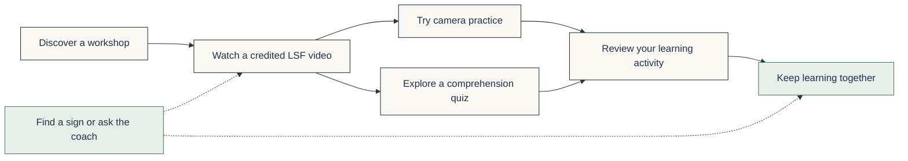
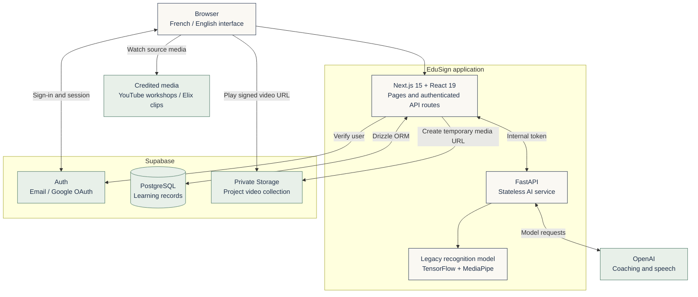
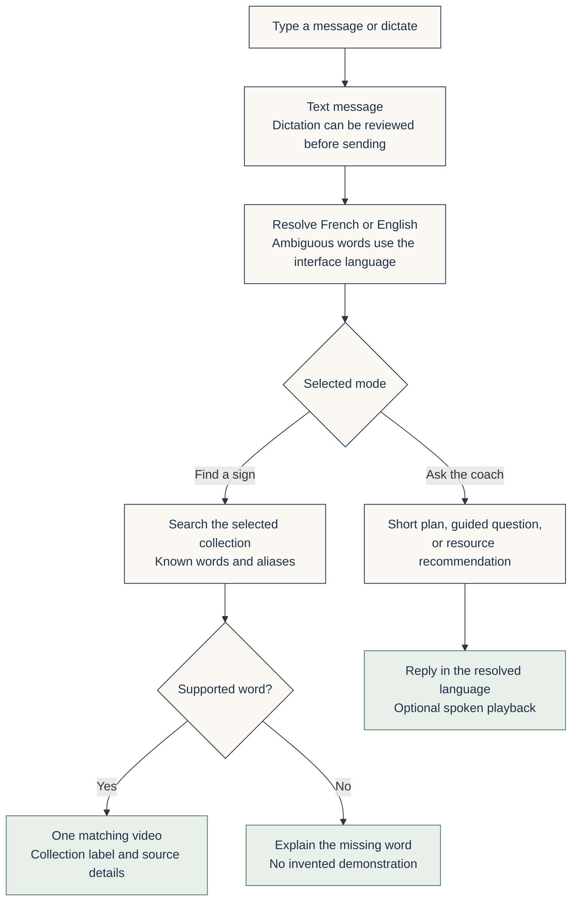

<div align="center">

# EduSign

### Watch. Try. Connect.

An **AI-powered platform for learning French Sign Language (LSF)**, designed for **children aged 3–15 and their parents**.

**Ages 3–15 · French & English · Video lessons · AI learning assistant · Parent–child learning**

[Explore the product](#the-product) · [Architecture](#architecture) · [Run locally](#run-locally) · [Documentation](#documentation)

</div>

---

EduSign helps children aged 3–15 and their parents learn French Sign Language together through video lessons, guided practice, interactive activities, and an AI-powered learning assistant. Parents can support their child while learning alongside them, even when they are new to sign language themselves.

For example, a parent who wants to teach their child “bonjour” can ask the assistant, find the supported demonstration in the sourced LSF collection, and watch it together. The bilingual coach also offers short learning plans and questions to help families decide what to practise next.

**LSF** means *Langue des signes française* — French Sign Language. Switching the interface to English translates the experience; the lessons continue to teach LSF.

*En français : EduSign est une plateforme d’apprentissage de la langue des signes française, enrichie par l’intelligence artificielle, conçue pour les enfants de 3 à 15 ans et leurs parents. Elle réunit des leçons vidéo, des activités interactives et un assistant bilingue pour apprendre ensemble.*

## Contents

- [The product](#the-product)
- [Architecture](#architecture)
- [How the assistant works](#how-the-assistant-works)
- [Built with Codex](#built-with-codex)
- [How I used OpenAI API credits](#how-i-used-openai-api-credits)
- [Run locally](#run-locally)
- [Configuration](#configuration)
- [Project structure](#project-structure)
- [Testing and verification](#testing-and-verification)
- [Learning records and privacy](#learning-records-and-privacy)
- [Current scope and next steps](#current-scope-and-next-steps)
- [Product film](#product-film)
- [Documentation](#documentation)
- [Contributing](#contributing)
- [Sources and licensing](#sources-and-licensing)

## The product

The product centres on **children learning with their parents**: watch a demonstration, try an activity, ask for guidance, and return to learning together. The current lesson catalogue begins with two workshops: **the alphabet** and **numbers**.



| Experience | What learners can do |
| --- | --- |
| **Discover** | Explore the homepage and filter the workshop catalogue in French or English. |
| **Watch** | Follow alphabet and numbers resources with learning objectives, creator credits, and direct source links. |
| **Practise** | Record a short camera attempt, replay it, and try again. Experimental recognition is available for a limited demo vocabulary. |
| **Reflect** | Answer optional comprehension questions and see explanations. Saved scores are recalculated on the server. |
| **Find a sign** | Search supported French or English words, open one matching video, and use slow playback or looping. |
| **Ask the coach** | Request short learning plans, answer interactive questions, dictate a message, or listen to a response. |
| **Learn together** | View activity records and quiz results, read parent guidance, and share a lesson link. |

> **Two collections, clearly distinguished.** The assistant includes six sourced LSF clips from Elix and a separate imported collection of 354 clips labelled **“Sign language unverified.”** Translated search labels do not establish a clip’s sign language. Select the sourced LSF collection for LSF demonstrations.

### Main pages

| Route | Purpose |
| --- | --- |
| `/` | Product introduction and workshop previews |
| `/courses` | Searchable lesson catalogue |
| `/learn/lsf-alphabet` · `/learn/lsf-nombres` | Video, camera practice, and comprehension quiz |
| `/tutor` | Video lookup and interactive coach |
| `/dashboard` · `/report` | Personal learning notebook and report |
| `/parents` · `/resources` | Family guidance and learning resources |
| `/community` | Shared activities and lesson sharing |
| `/about` · `/packages` | Project mission and planned offers |

## Architecture

The **Next.js application** owns the user experience, session checks, and learning-data access. The **FastAPI service** handles assistant requests, speech, report insights, and experimental recognition. Supabase provides authentication, PostgreSQL, and private video storage.



The Python service has **no direct database connection**. Next.js sends the context needed for each request. Browser-facing assistant, voice, and recognition routes require an authenticated Supabase user; the internal gateway supplies `X-Internal-Token` when configured.

| Layer | Technologies |
| --- | --- |
| Web | Next.js 15, React 19, TypeScript |
| Interface | Tailwind CSS, Radix Slot, Lucide icons, Recharts |
| Identity and data | Supabase Auth, PostgreSQL, Drizzle ORM, Supabase Storage |
| AI service | Python, FastAPI, OpenAI SDK, Pydantic |
| Experimental recognition | TensorFlow, MediaPipe, OpenCV |
| Verification | Node.js test runner, Python unittest, HTTP and connected journey scripts |

## How the assistant works

The assistant separates **finding a known video** from **generating learning guidance**. A word lookup uses a deterministic catalogue; it does not ask a language model to invent a sign or media URL.



- **Language follows the message.** `bonjour` receives a French response; `hello` receives an English response, even when the interface uses the other language. Shared words, letters, and numbers use the interface language.
- **The collection controls the demonstration.** In the sourced LSF collection, `bonjour` selects Elix’s Bonjour clip. The imported collection resolves to its own corresponding clip and retains its unverified label.
- **Coaching is grounded in selected resources.** Responses use structured output and approved resource identifiers. Guided questions are checked on the server; fallback guidance is explicitly labelled.
- **Voice is optional.** Dictation records up to 60 seconds and offers an editable transcript. Replies have individual playback controls; automatic reading is optional.
- **Conversation history is temporary.** Messages remain in the current page session and survive an interface-language switch; there is no persistent conversation archive.

Text lookup and guided exercises require the Python service but do not require an OpenAI key. Generative coaching and speech require a working provider configuration. The workshops remain available when the AI service is offline.

## Built with Codex

I used **OpenAI Codex as a development partner** to build and refine EduSign around a clear product goal: help children aged 3–15 and their parents learn French Sign Language together. The work began with an existing application, video collection, and recognition model. Those assets were preserved while the learning experience, bilingual assistant, and supporting workflows were developed further.

I provided the product direction, examples of how parents would use the assistant, and feedback on the interface. Codex helped turn that direction into implementation changes, inspect the running application, run checks, and document the result. A central example was: **a parent asks for “bonjour,” receives the corresponding demonstration, and watches it with their child.**

| Area | How I worked with Codex |
| --- | --- |
| **Product and interface** | Reviewed the existing project, clarified the child-and-parent audience, redesigned the homepage and assistant, and unified colours and feedback states. |
| **Bilingual experience** | Added French/English interface copy and message-language handling so supported French requests receive French replies and English requests receive English replies. |
| **Video assistant** | Connected supported-word lookup to the video catalogue, prepared playback derivatives, integrated private Supabase storage, and kept sourced LSF clips distinct from unverified project clips. |
| **Interactive coaching** | Implemented short learning plans, contextual follow-ups, server-checked questions, editable voice transcripts, and spoken responses. |
| **Learning records** | Developed viewing-progress tracking, server-graded quiz persistence, and reports that distinguish activity from signing proficiency. |
| **Review and verification** | Used computer-use tools to inspect real screens and interactions, alongside TypeScript, lint, build, Python, HTTP, and temporary-account checks. Verification limits are recorded in the product plan. |
| **Launch presentation** | Captured real application screenshots and assembled the product film with editorial motion, AI narration, captions, music, and creator credits. |
| **Documentation and delivery** | Wrote architecture diagrams and setup guides, organised changes into focused commits, and pushed the project to GitHub. |

The development process was iterative: **describe a user need → implement → inspect the real experience → test → refine**. Browser feedback informed the next changes, particularly the sign-language focus of the homepage, the assistant’s demonstration layout, and visible practice feedback.

Codex’s role here was development and production assistance. The running application uses its own FastAPI service and configured OpenAI API models for its AI features. The [product plan](docs/EDUSIGN_PLAN.md) and Git history document the implementation work; original media and model weights remain preserved.

## How I used OpenAI API credits

I used **OpenAI API credits to develop and test EduSign’s AI interactions**, including French and English coaching, speech transcription, spoken replies, and the launch-film narration. The project also uses provider-generated report insights to explain recorded learning activity.

| Use of API credits | What the requests support | Implementation |
| --- | --- | --- |
| **Bilingual coaching** | Short learning plans, conversational follow-ups, and suggestions linked to selected LSF resources. | [Coaching service](ai-service/app/lsf.py) |
| **Voice input** | Transcribing a recorded message so the user can review and edit it before sending. | [Speech adapter](ai-service/app/voice.py) |
| **Spoken responses** | Reading assistant replies aloud in the resolved response language. | [Speech adapter](ai-service/app/voice.py) |
| **Learning reports** | Generating family-oriented summaries and suggestions from recorded activity and quiz data. | [Report insights](ai-service/app/report.py) |
| **Live evaluation** | Testing French and English prompts, follow-up questions, and the synthesis → transcription → coaching → speech pipeline with synthetic examples. | [Opt-in provider checks](ai-service/tests/verify_live_coach.py) |
| **Launch-film production** | Generating the English narrator and transcribing that narration to obtain word timings for captions. | [Narration preparation](launch-film/prepare.py) · [Caption alignment](launch-film/align-captions.py) |

The optional [French label-authoring helper](ai-service/scripts/translate_sign_labels.py) also uses the API to translate catalogue labels for search. These labels are stored in the repository, so they do not need to be regenerated for each lookup. Translating a label does not validate the sign shown in its video.

Several parts of EduSign run without OpenAI requests: deterministic video lookup, interface translations, guided-question grading, media playback, and the local experimental recognition model. Speech playback is user-controlled, automated live-provider tests require `--live-api`, and film-generation scripts reuse existing audio outputs. These choices keep API usage tied to the features and development checks that need it.

Provider credentials are loaded from ignored environment files on the server. The [configuration section](#configuration) lists the model settings; the [testing section](#testing-and-verification) distinguishes local checks from billable provider calls.

## Run locally

### Prerequisites

- Node.js 20 or newer, with npm.
- Python 3.10 or 3.11 for the pinned recognition dependencies. The AI Dockerfile uses Python 3.11.
- A Supabase project with database access and API keys.
- An OpenAI API key for generative coaching and voice.
- FFmpeg and FFprobe only if preparing video derivatives or rendering the product film.

Commands below assume a macOS/Linux shell. Start from the repository root and use separate terminals for the two services.

### 1. Install and configure the web application

```sh
cd edusign-next
npm ci
cp -n .env.local.example .env.local
```

Fill in `.env.local` using the [configuration reference](#configuration). Keep existing credentials: `.env.local` takes precedence over `.env`. Use the exact **Transaction pooler** connection string supplied by your Supabase project.

### 2. Prepare the database and start the app

Run these commands inside `edusign-next/` after configuring the environment:

```sh
npm run db:setup
npm run db:seed
npm run config:check
npm run db:verify
npm run dev -- --port 3100
```

`db:setup` applies migrations, profile triggers, and ownership policies. `db:seed` publishes the alphabet and numbers workshops, unpublishes known legacy courses, and disables known legacy packages. It preserves users and learning history. Use a development Supabase project when setting up a new environment.

Open **http://localhost:3100**.

### 3. Install and start the AI service

In a second terminal, starting at the repository root:

```sh
cd ai-service
python3.11 -m venv .venv
.venv/bin/python -m pip install -r requirements.txt
cp -n .env.example .env
```

Set `OPENAI_API_KEY` in `ai-service/.env`. If using an internal token, put the same `INTERNAL_API_TOKEN` in both services. Then start FastAPI:

```sh
.venv/bin/python -m uvicorn app.main:app --host 127.0.0.1 --port 8100
```

The health endpoint is **http://localhost:8100/health**. Its `openai` field indicates that a key is configured, not that every configured model or quota is available. The assistant’s status check verifies provider/model access separately.

### 4. Configure authentication and media

Set Supabase’s site URL and callback allowlist to match `http://localhost:3100`. Email confirmation and password recovery need working email delivery; Google sign-in needs its provider configuration. Follow [the authentication guide](docs/AUTH_SETUP.md).

A fresh clone does **not** include the large imported video library, generated derivatives, or launch-film captures. Project-library playback requires the matching objects in the private `sign-demonstrations` bucket. See [video-library setup and synchronization](docs/SIGN_VIDEO_LIBRARY.md). The sourced Elix collection has its own [attribution record](edusign-next/public/signs/ATTRIBUTION.md).

For a local production build, stop the development server before running:

```sh
# Inside edusign-next/
npm run build
npm run start -- --port 3100
```

## Configuration

Copy the checked-in examples; never commit real keys. Only the Supabase URL and publishable key belong in browser configuration. Database credentials, service-role keys, OpenAI keys, and the internal token stay server-side.

### Web application — `edusign-next/.env.local`

| Variable | Purpose |
| --- | --- |
| `NEXT_PUBLIC_SITE_URL` | Application origin for authentication links; locally `http://localhost:3100`. |
| `SUPABASE_URL` | Supabase project URL. Supported public aliases are documented in the configuration helper. |
| `SUPABASE_PUBLISHABLE_KEY` | Browser-safe Supabase API key. |
| `SUPABASE_SECRET_KEY` | Server-only administrative access and private-video URL signing. |
| `DATABASE_URL` | PostgreSQL transaction-pooler connection string. |
| `MIGRATION_DATABASE_URL` | Optional migration connection; falls back to `DATABASE_URL`. |
| `AI_SERVICE_URL` | FastAPI origin; locally `http://localhost:8100`. |
| `INTERNAL_API_TOKEN` | Shared secret sent to FastAPI. Set a matching nonempty value when deploying. |
| `NEXT_PUBLIC_MEDIA_BASE_URL` | Optional base URL for existing media paths; separate from private sign-video signing. |
| `EDUSIGN_STANDARD_MONTHLY_EUR` | Optional Standard plan display price. Does not enable payment. |
| `EDUSIGN_TUTOR_MONTHLY_EUR` | Tutor plan display price; current default is €99/month. |
| `EDUSIGN_SCHOOLS_EMAIL` | Public school-enquiry address displayed on the Plans page. |

### AI service — `ai-service/.env`

| Variable | Purpose / configured default |
| --- | --- |
| `OPENAI_API_KEY` | Provider key for generative coaching and voice. |
| `INTERNAL_API_TOKEN` | Must match the web gateway’s token. An empty value skips internal authentication for local development. |
| `OPENAI_TUTOR_MODEL` | Coaching model; `gpt-4o-mini`. |
| `OPENAI_TRANSCRIBE_MODEL` | Transcription model; `gpt-transcribe`. |
| `OPENAI_TTS_MODEL` | Speech model; `gpt-4o-mini-tts`. |
| `AI_SERVICE_PORT` | Port used by the Python entry point; defaults to `8100`. An explicit Uvicorn `--port` takes precedence. |

Model names above reflect the repository’s configuration defaults. Confirm access with your provider account and override them as needed. Restart the AI service after changing its environment.

## Project structure

```text
.
├── edusign-next/                 # Web application and authenticated gateway
│   ├── src/app/                  # Pages, auth callbacks, and API routes
│   ├── src/components/           # Lessons, assistant, reports, and shared UI
│   ├── src/lib/
│   │   ├── data/                 # Workshop and sign-video catalogues
│   │   ├── db/                   # Drizzle connection and schema
│   │   ├── i18n/                 # Locale handling and English translations
│   │   ├── quiz/                 # Versioned questions and server grading
│   │   └── video/                # Viewing-progress tracking and persistence
│   ├── public/signs/             # Sourced Elix clips and attribution
│   ├── drizzle/                  # Database migrations and ownership policies
│   ├── scripts/                  # Setup, media synchronization, smoke checks
│   └── tests/                    # Web contract and logic tests
├── ai-service/
│   ├── app/                      # Coaching, lookup, voice, reports, recognition
│   │   ├── data/                 # Mirrored catalogues and prompt resources
│   │   └── models/               # Preserved legacy recognition weights
│   ├── tests/                    # Python tests and opt-in live verification
│   ├── requirements.txt          # AI and pinned recognition dependencies
│   └── Dockerfile                # Python 3.11 service image
├── docs/                         # Product history, auth, and media guides
├── launch-film/                  # Film sources, edit plan, and production record
└── AGENTS.md                     # Repository contribution instructions
```

## Testing and verification

### Local code checks

```sh
# Inside edusign-next/
npm run typecheck
npm run lint
npm test
npm run build
```

```sh
# Inside ai-service/
.venv/bin/python -m unittest discover -s tests
```

### HTTP checks

With the web app running on **port 3100**, run from `edusign-next/`:

```sh
node scripts/smoke-auth.mjs
node scripts/smoke-http.mjs
node scripts/smoke-locales.mjs
node scripts/smoke-product-pages.mjs
node scripts/verify-lsf-links.mjs
```

### Connected checks — explicit opt-in

Use a test Supabase project. These scripts create temporary accounts and clean them up afterward. Start the web app on **3100** and the AI service on **8100** for the full journey and assistant checks.

```sh
# Inside edusign-next/
node scripts/verify-auth.mjs --temporary-user
node scripts/verify-ownership.mjs --temporary-users
node scripts/verify-signup.mjs --temporary-user
node scripts/verify-learner-journey.mjs --temporary-user
node scripts/verify-tutor.mjs --temporary-user
```

The signup test verifies confirmation without sending email. It does not prove SMTP delivery or the complete browser OAuth flow.

An optional real-provider check exercises synthetic French and English conversations and the speech pipeline. It makes billable API calls:

```sh
# Inside ai-service/
.venv/bin/python tests/verify_live_coach.py --live-api
```

Compilation, HTTP tests, and synthetic speech tests do not replace browser review. Verify real microphone input, camera capture, YouTube playback, mobile layouts, and authentication redirects separately.

### Troubleshooting

| Symptom | Check |
| --- | --- |
| Assistant reports unavailable | FastAPI is running on `8100`; `AI_SERVICE_URL` is correct; internal tokens match. |
| Text works but voice fails | Provider key, model access, and quota; microphone permission for dictation; restart after environment changes. |
| Project-library video will not play | User session, `SUPABASE_SECRET_KEY`, matching catalogue objects, and private-bucket synchronization. |
| Database or profile error | Pooler URL, `db:setup`, and `db:verify`. Check whether `.env.local` overrides an older `.env`. |
| Google sign-in unavailable | Enable and configure Google in Supabase, including callback URLs. |
| Confirmation email missing | SMTP configuration, authorized recipients, and authentication redirect settings. |

## Learning records and privacy

EduSign keeps different signals separate so the report is understandable:

| Record | Meaning |
| --- | --- |
| Practice completion | A learner’s declaration that they tried an activity. |
| Video progress | Estimated active playback, unique coverage, and last position. Pauses, buffering, background time, and large seeks are excluded. |
| Quiz score | Comprehension answers for a versioned quiz; saved results are recalculated on the server. |
| Recognition result | Experimental demo feedback, not a certified signing score and not recorded as one. |

Anonymous quiz attempts remain on the page. Signed-in results are saved to Supabase. Viewing progress does not establish attention or mastery; the last unsent interval can be lost if the connection closes. One account currently represents a shared notebook, without separate child profiles.

Camera recordings capture no audio. Anonymous practice stays local; authenticated analysis sends up to 30 reduced JPEG frames to the Python service for in-memory processing. The service does not save those frames to disk. Dictation and spoken replies use the configured speech provider. The French/English coach prompt receives selected progress aggregates without the profile’s name or age, alongside conversation text supplied by the user.

Private project clips are served through authenticated catalogue IDs and temporary signed URLs. A copied URL can remain usable until its one-hour expiry. Original local media is preserved in its existing public-assets location; private Storage does not retroactively make those source files private.

## Current scope and next steps

EduSign’s intended audience is children aged **3–15 and their parents**. The current release provides a focused set of beginner learning experiences, with the following scope and development priorities.

- **Learning content:** two workshops and a small sourced LSF clip collection. Review the pedagogy and demonstrations with qualified LSF contributors before expanding the curriculum.
- **Gesture analysis:** the legacy model covers A/B/C and 1/2/3. Its class ordering is assumed, confidence is uncalibrated, and accuracy has not been validated for LSF. Feedback can be a match, a different prediction, or uncertain.
- **Voice and devices:** automated bilingual speech checks exist; physical microphone and mobile-device coverage still need broader verification.
- **Accounts:** no separate child profiles or persistent assistant history yet.
- **Plans and community:** paid offers are informational; checkout and booking are not enabled. The community page provides activities and sharing, not a member forum.
- **Deployment:** complete deployed authentication/email checks, content-rights review, and operational validation before a public launch.

The [product plan](docs/EDUSIGN_PLAN.md) records implementation history and earlier verification snapshots. Later dated entries supersede older descriptions.

## Product film

The repository includes the sources for a **120-second, 1920 × 1080 launch film**: real application screenshots, editorial motion, English AI narration, captions, an original instrumental score, and a separately credited Elix source-video excerpt.

See the [production guide and credits](launch-film/production-guide.html), [edit plan](launch-film/edit-plan.json), and [production record](launch-film/production-report.json).

The MP4, narration, and source captures are local artifacts excluded from Git. When available, the main export is `launch-film/renders/EduSign-launch-120s.mp4`. Re-rendering requires the original capture/audio directories, FFmpeg, Pillow, NumPy, and the fonts documented by the renderer. The film is an animated product walkthrough, not continuous screen recording.

## Documentation

| Guide | Use it for |
| --- | --- |
| [Product plan](docs/EDUSIGN_PLAN.md) | Scope, decisions, implementation history, and verification notes |
| [Authentication setup](docs/AUTH_SETUP.md) | Supabase email, Google OAuth, redirects, and account checks |
| [Video library](docs/SIGN_VIDEO_LIBRARY.md) | Collections, media preparation, private storage, and bilingual lookup |
| [Elix attribution](edusign-next/public/signs/ATTRIBUTION.md) | Source files, creators, conversion notes, and licenses |
| [Web environment example](edusign-next/.env.local.example) | Web application configuration |
| [AI environment example](ai-service/.env.example) | Provider and internal-service configuration |
| [Workspace instructions](AGENTS.md) | Contribution rules and required checks |

## Contributing

Read [AGENTS.md](AGENTS.md) and the product plan before making architectural changes.

1. Keep interface changes bilingual. Use the locale provider and add English copy and accessible labels to `edusign-next/src/lib/i18n/en.json`.
2. Reuse the shared colour tokens in `edusign-next/src/app/globals.css` and `tailwind.config.ts`. Keep success and warning states distinct.
3. Preserve source media, model weights, learner history, and creator credits. Never label an unverified collection as LSF.
4. Version changed published quiz questions with a new quiz identifier so historical results retain their meaning.
5. Run the relevant checks, review changed screens in a real browser, and state any interactions that remain unverified.
6. Make focused commits with accurate descriptions. Keep credentials and generated media out of Git.

## Sources and licensing

- **Alphabet workshop:** MAE Langue des Signes. **Numbers workshop:** Dico Plus LSF. Lessons embed the original publications and retain creator attribution; their metadata is in the [LSF catalogue](edusign-next/src/lib/data/lsf-catalog.json).
- **Sourced sign clips:** Elix — Signes de sens, distributed under **CC BY-SA 4.0**, with original URLs, license links, and adaptation notices in the [attribution file](edusign-next/public/signs/ATTRIBUTION.md).
- **Imported project clips:** retained from the existing project. Their sign language is unverified; translated labels are search aids, not linguistic validation.

EduSign is not affiliated with the referenced creators or dictionaries. Media retains its respective rights and licenses. No standalone project-wide `LICENSE` file is currently included; do not assume the application code or imported media has an open-source redistribution license.
